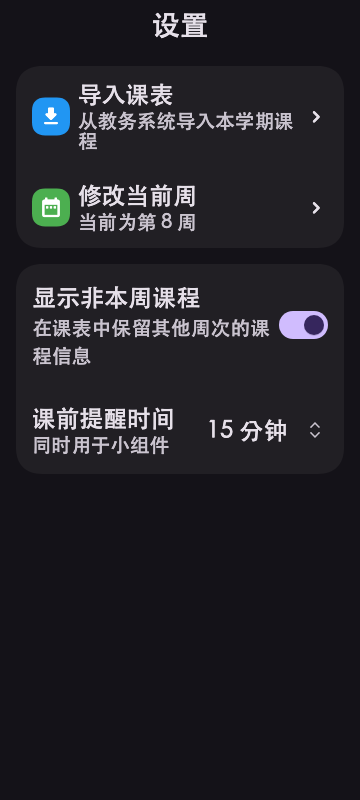
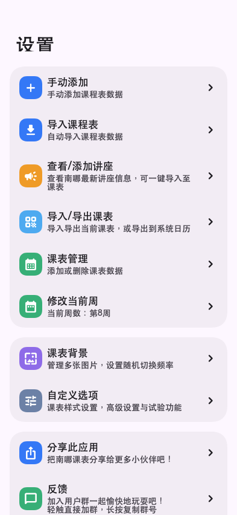
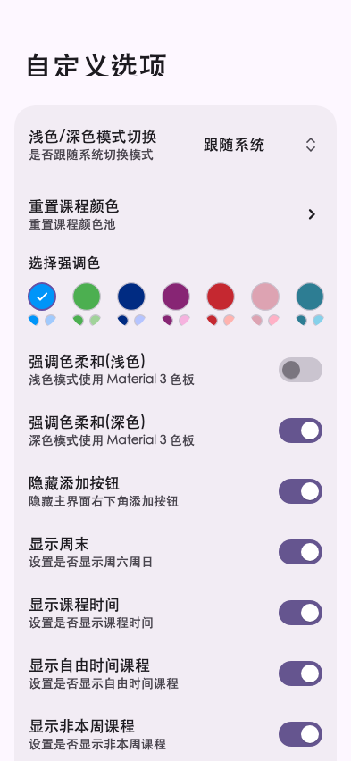

# 设置页 MIUIX 探索

日期：2026-10-26。分支：`codex/settings-miuix`。

结论：设置组件替换可行，已实现探索版。鸿蒙插件的 Dart 平台判定与 package_info_plus 的 Android SDK 空值兼容问题已通过本地补丁处理，已构建并校验 Android release 测试包；鸿蒙 SDK 升级与真机验证仍需后续处理。

## 范围

迁移设置主页、更多设置、背景设置、小组件设置、实时活动设置及 Android 实时活动组件，以及周次、课程高度、主题色和背景轮换弹窗。保留原有状态模型、持久化、埋点、导航目标和平台入口。

| 原组件 | 探索版 |
| --- | --- |
| Scaffold / AppBar / SliverAppBar | MiuixScaffold / MiuixTopAppBar；大字体时用 MiuixSmallTopAppBar |
| 分组 Material 卡片 | MiuixCard |
| ListTile | MiuixBasicComponent，保留异步摘要和长按复制 |
| Switch / SwitchListTile | MiuixSwitch / MiuixSwitchPreference |
| DropdownButton | MiuixOverlayDropdownMenu |
| CupertinoPicker / 数值编辑 | MiuixNumberPicker |
| AlertDialog / MDialog | MiuixOverlayDialog，使用原 Navigator 返回结果 |
| TextField / 背景操作按钮 / 加载指示器 | 对应 MIUIX 输入、按钮、进度组件 |

`Widgets/MiuixSettings.dart` 为页面提供共用适配层；主题限定在设置页面内，跟随应用深浅色、字体与强调色。主题色预览、照片网格等应用专有内容保留 Flutter 布局组合。

修复了验证中发现的两个问题：嵌套菜单在列表行右侧收到无限宽度约束；大字体下上游展开标题裁切。页面外壳统一消费安全区，避免子页重复留白。

## SDK 与依赖结论

- 固定 `flutter_miuix: 1.3.0`，将应用 Dart 下限设为 3.12.2。
- [pub.dev 包元数据](https://pub.dev/api/packages/flutter_miuix)显示，所有已发布版本（1.0.0 至 1.3.0）都要求 Dart `^3.12.2`，降版本无法绕过此门槛。
- 本机默认 Flutter 的 Dart 为 3.7.2；原有鸿蒙 Flutter（`/Users/aritxonly/flutter_flutter`）的 Dart 为 3.6.2，均低于要求。
- 使用本机 `hyper-piliplus-flutter-3.47.2`（Dart 3.13.2）完成包解析、静态检查和组件验证。
- 完整页面测试编译被现有鸿蒙插件阻塞：`fluttertoast` 引用 `Platform.isOhos`；`mobile_scanner` 引用 `TargetPlatform.ohos`。标准 Flutter 不提供这些 API。为本次 Android 测试包，将这两个固定版本的插件放到 `third_party/`，分别改用 `Platform.operatingSystem` 与枚举 `name` 检测 OHOS，保留原生实现。
- 后续需升级到 Dart ≥3.12.2 的鸿蒙 Flutter，或单独完成这些插件的跨平台兼容改造，再验证完整应用与设备行为。此次仅修改插件的 Dart 平台判定。

工作树的 `external/` 忽略目录链接到本机已有依赖；缺失的 `device_calendar_ohos` 使用已有缓存，最初的 `flutter_plus_plugins_package_info_plus` 链接到现有的 plus_plugins checkout。其实际版本为 4.2.0，现已复制到 `third_party/package_info_plus`，修复 Kotlin 2.2 / Android SDK 36 下的三处空值兼容问题，保留 OHOS 实现。lockfile 对应 package_info_plus / platform_interface 为 4.2.0 / 2.0.1（原 lockfile 为 8.3.0 / 3.2.1）；这是当前本机可用插件基线，合入发布前仍需确认版本策略。

## 验证

- 设置目录和新增测试目录静态分析：无编译错误。
- `flutter test --no-pub test/Pages/Settings/miuix_settings_test.dart`：7 项通过，覆盖深浅色、点击与长按、禁用状态、开关、菜单选择与关闭、弹窗返回值、360px 宽与 1.4 倍字体。
- `settings_pages_test.dart` 的 4 项页面测试覆盖实际设置主页、更多设置、小组件设置及背景设置的深浅色：全部通过；与组件测试合计 11 项通过。
- Android release APK 构建成功，apksigner v2 签名验证通过，证书为 Android Debug；尚未完成模拟器或真机验证，系统权限、通知、图片选择等原生行为尚未实测。

验证命令中的 `flutter` 指本机新版 SDK；普通默认 SDK 无法解析本次依赖。

## Android 测试构建

使用新版标准 Flutter、Gradle 8.14.3 与 NDK 28.2.13676358。未配置 `android/key.properties` 时，release 使用默认 Android debug keystore 签名；已配置发布密钥时仍优先使用原发布密钥。目标架构 arm64-v8a。

本机 Flutter 生成的插件注册文件残留 integration_test，而 Gradle release 已排除 dev 插件，导致 Java 编译错误；本次构建从忽略的自动生成文件中移除这条测试插件注册。若再次执行 pub get 或测试后出现相同错误，应重新生成与 release 模式一致的插件注册文件。

## 组件预览

以下为测试中组合的 MIUIX 设置组件，360×800、1.4 倍字体，**不是完整应用页面截图**。

| 浅色 | 深色 |
| --- | --- |
|  |  |

## 工作树基线

新工作树从当前 HEAD 创建，并复制原目录未提交改动作为探索基线，包括原有实况通知实现。原目录内容未修改；本分支的全部 Git diff 因而也包含复制过来的既有改动。尚未提交、推送或创建 PR。

实际页面预览（由页面测试生成）：

## 最终 Android 产物

- 文件：`build/app/outputs/flutter-apk/app-release.apk`，约 21.0 MB。
- 版本：4.1.0+71；包名：com.lilystudio.wheretosleepinnju。
- Flutter 引擎目标：android-arm64；最低 Android API 24，targetSdk 33。
- 默认 debug keystore 签名，APK Signature Scheme v2 校验通过。
- SHA-256：`286fe94979610cdf9d01197f3be100b7f389dddcc639a823055143db6d99c2cb`。
